<!-- SPDX-FileCopyrightText: Etienne-T -->
<!-- SPDX-License-Identifier: CC0-1.0 -->

# Porting OpenWrt to the Mercusys Halo H80X v1

> **About this text.** This story was written by AI agents from the project's
> journal and test reports. Other AI agents checked it claim by claim. It
> will be reviewed by the repository owner before publication. It describes
> the software work as it stood on **13 November 2026**, with later
> owner-supplied photographs and a follow-up on factory-setup access tests
> (section 7).
>
> It is **not** official OpenWrt documentation or support. The Halo H80X is not
> an OpenWrt-supported device, nothing described here has been submitted to the
> OpenWrt project, and the OpenWrt tests described here used **a single unit**.

## In short

- Since 13 November 2026, OpenWrt (snapshot of `main`, Linux 6.18) runs from
  the flash of one H80X, in the second firmware bank. According to the
  journal, the write targeted that bank, not the first bank that holds the
  stock firmware; the first bank was not read back after installation.
- Seen working on the hardware: Ethernet through the RTL8367S switch (three
  ports), the status and port LEDs, the reset button at the electrical level,
  both Wi-Fi radios (2.4 GHz and 5 GHz, `ath11k` driver), and the unit's own
  MAC addresses.
- The only installation route demonstrated in this project uses the serial
  console. According to static analysis, the stock web page and the
  bootloader's recovery page only accept firmware signed by the vendor.
- Main limits: the Wi-Fi board data files come from the stock firmware and
  may not be redistributable, so Wi-Fi cannot be rebuilt from this repository
  alone; 5 GHz channels 100 and above are unavailable in the tested
  configuration; the CPU–switch link runs at 1 Gbit/s; going back to the
  stock firmware is documented but has never been tested end to end.

## 1. The device and the motivation

The Halo H80X v1 is a mesh Wi-Fi unit sold by Mercusys, a TP-Link brand. Its
stock firmware is a vendor system built on OpenWrt, with Linux 4.4.60 and a
U-Boot 2016.01 bootloader built on 11 May 2022. The tested unit ran stock
version 1.1.0 (Build 20220706) in both of its firmware banks.

Searches made on 12 and 13 November 2026 found no OpenWrt pull request
mentioning the H80X. The only OpenWrt forum thread found about it dates from
2022 and ended without a result. The intended end use, an OpenWrt access
point with one VLAN per Wi-Fi network (SSID), has not been validated yet.

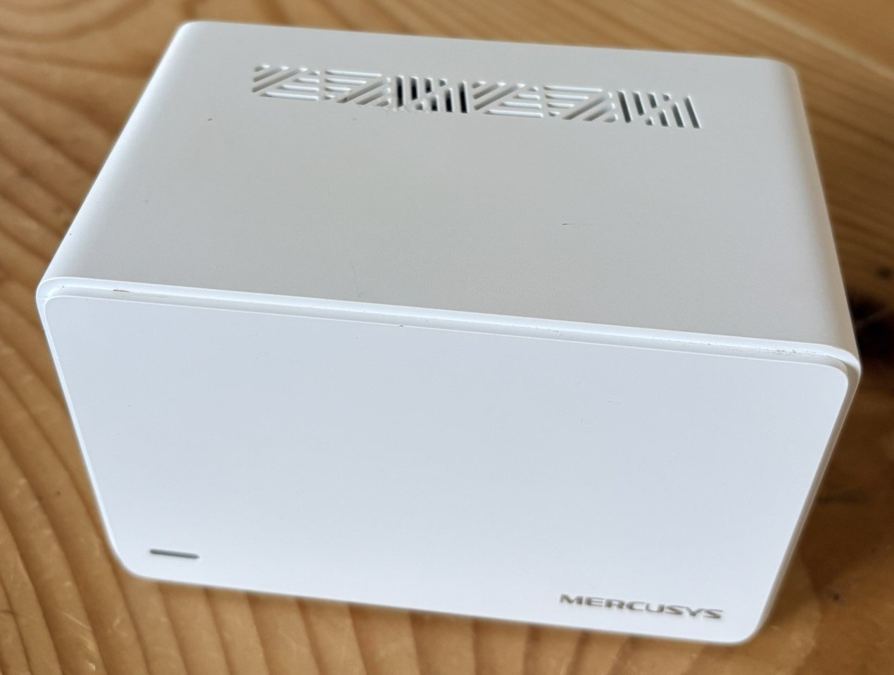

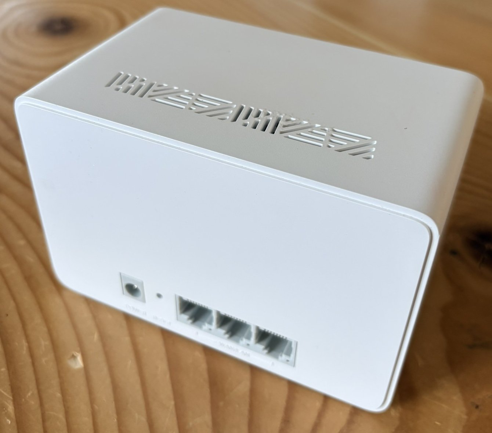

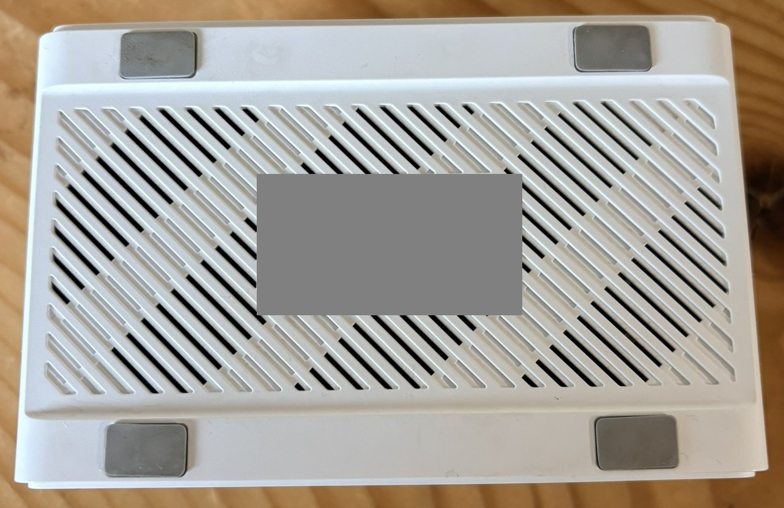

## 2. Opening the case and the board

The owner reports the same procedure on both units:

1. Remove the four feet from the underside. Two holes contain Phillips
   screws; the other two holes are empty.
2. Remove the two screws.
3. Pry along the visible groove in the case. Opening requires force.
   The owner used plastic tools to avoid breaking the case.

A Russian-language [review on DNS Club](https://club.dns-shop.ru/review/t-280-marshrutizatoryi/85194-obzor-domashnei-wi-fi-mesh-sistemyi-mercusys-halo-h80x-kompaktno/),
posted by the user STNVIDNOYE with photographs watermarked
`sergeytroshin.ru`, shows further views of the device, including the board
with its shields removed. Those photographs belong to their author and are
not part of this repository.

The board can stay in the case: the UART pads are accessible once the case
is open. The owner thinks a small soldering iron could reach the pads without
removing the board. This has not been verified.

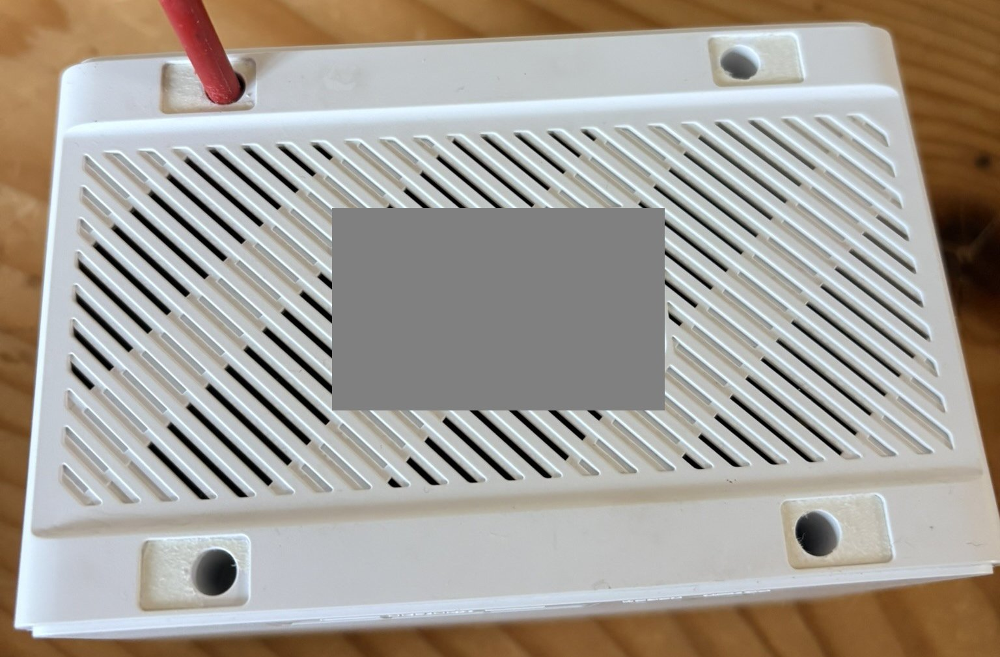

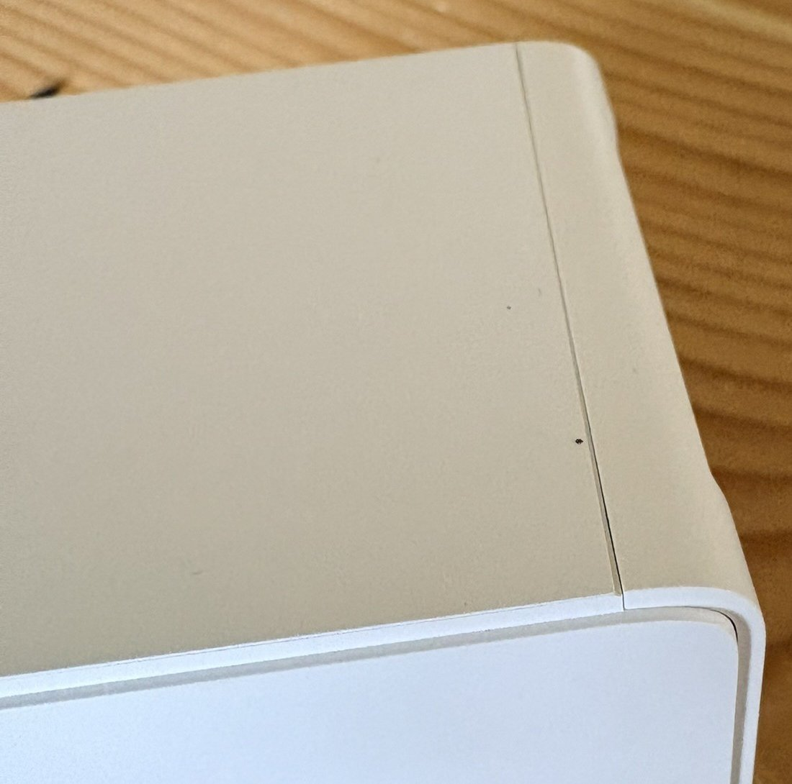

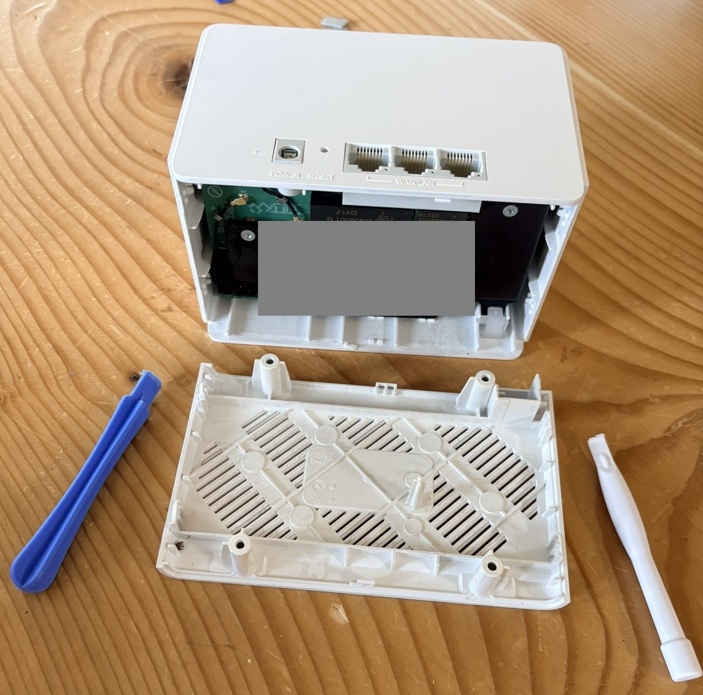

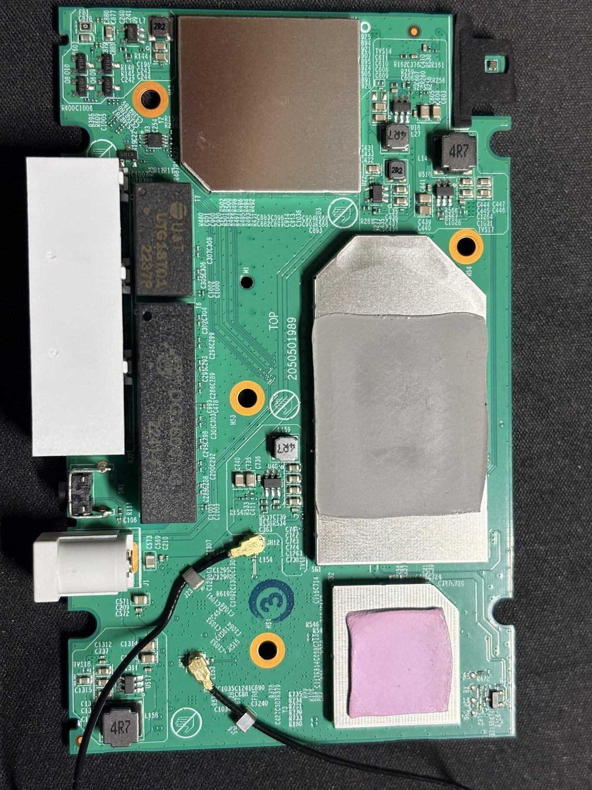

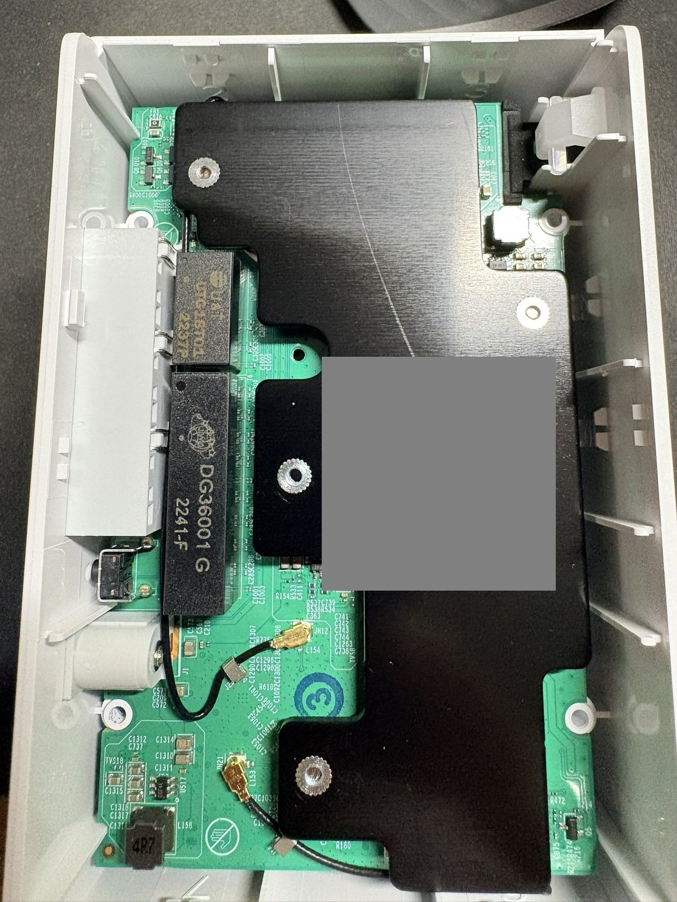

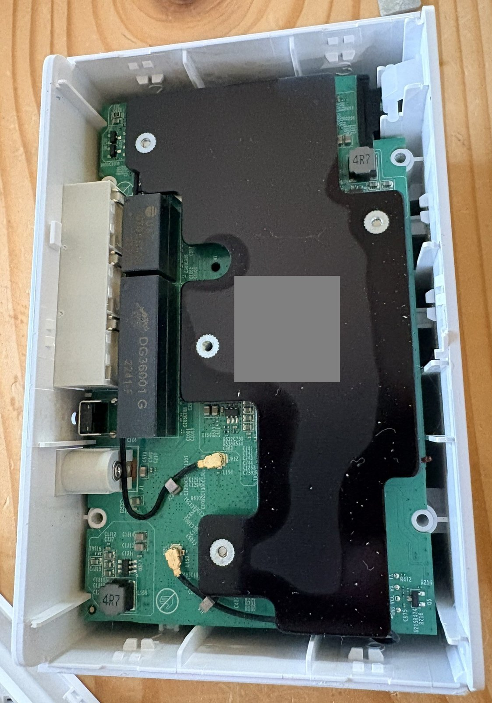

**Antenna mounting.** Two cabled PCB antennas sit against opposite inner
side walls, next to the rear connector openings. Their coaxial cables stay
connected when the board is lifted: disconnect power first, stop before
either cable becomes taut, and do not pull on the cables, solder joints,
connectors or UART leads. [HARDWARE.md](HARDWARE.md#antenna-mounting)
describes the mounting and what the photographs do not establish (connector
type, antenna-to-band assignment, adhesive).

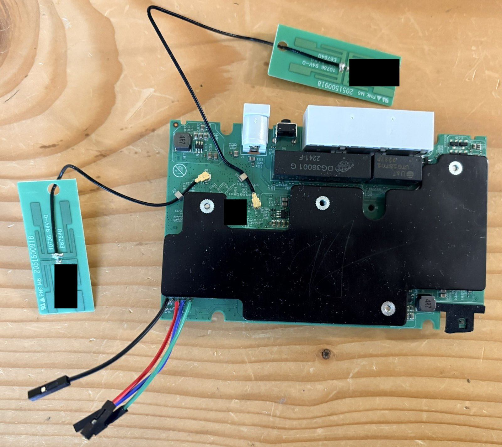

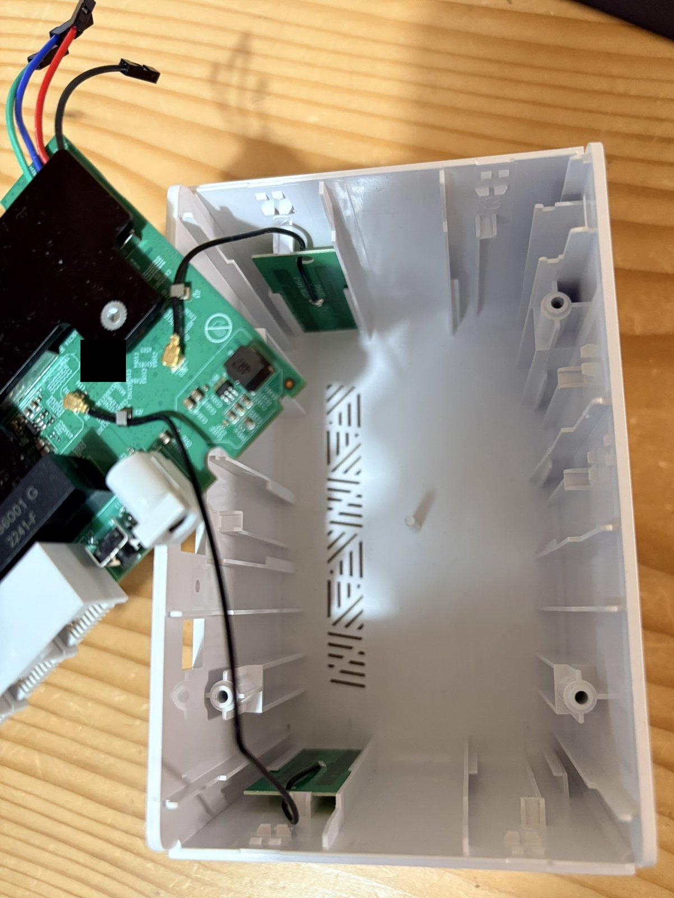

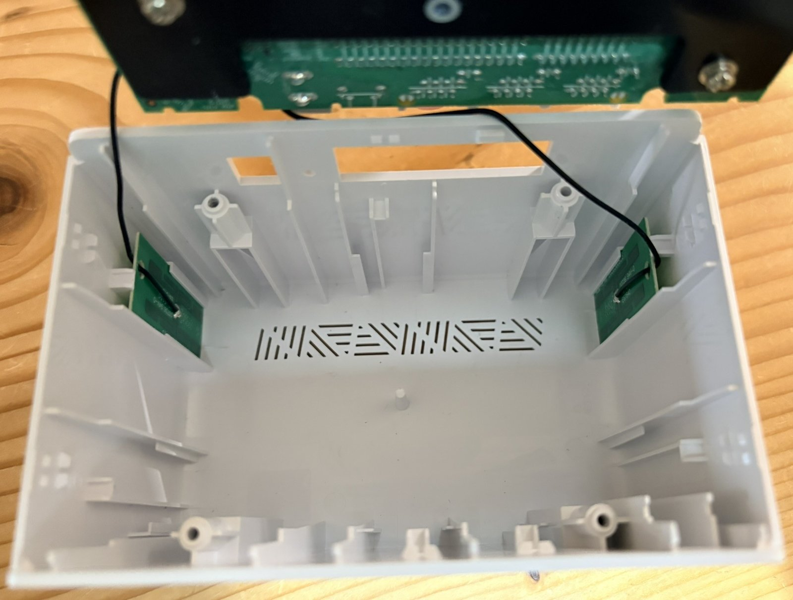

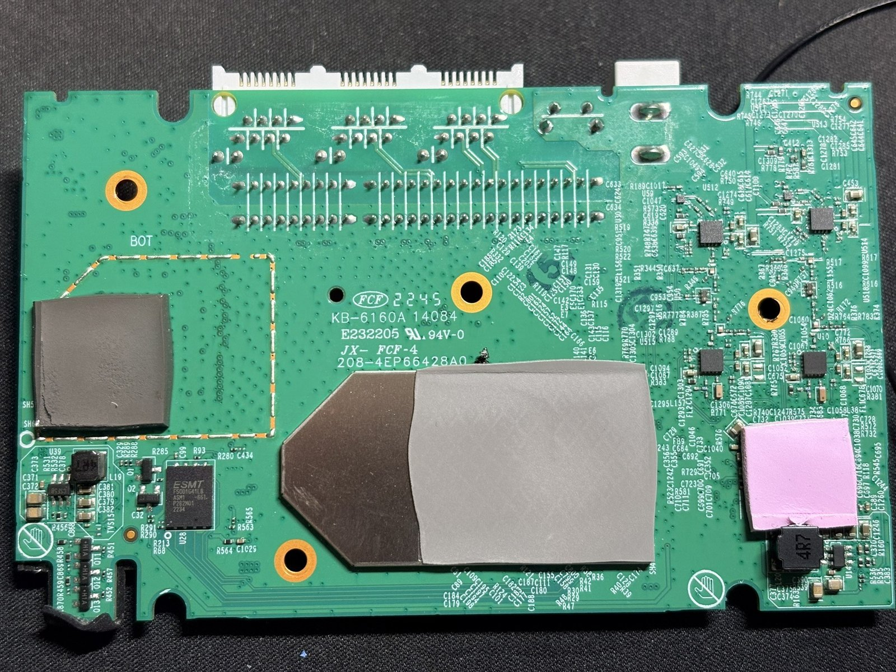

## 3. The main chips

| Part | What | How it was identified |
|---|---|---|
| SoC | Qualcomm IPQ5018, two cores, 512 MiB RAM; reference design AP-MP03.3 (`machid 0x8040002`) | Bootloader output and prompt (`IPQ5018#`) |
| Flash | ESMT F50D1G41LB SPI-NAND, 128 MiB, 2048-byte pages, 64-byte spare area, 4-bit ECC, a 1.8 V part, no bad blocks found | Chip marking and Linux detection for the part; bootloader output for geometry and bad-block scan |
| Switch | Realtek RTL8367S, three RJ45 ports on switch ports 0–2, CPU on port 6 | Found by the Linux `rtl8365mb` driver at MDIO address 0x1d |
| 2.4 GHz Wi-Fi | Radio built into the IPQ5018 | Stock device tree, then `ath11k` |
| 5 GHz Wi-Fi | Qualcomm QCN6122, started by the SoC's Q6 co-processor (not a PCIe device seen by Linux) | Stock device tree, then `ath11k` |

Linux detects the flash as an ESMT SPI-NAND in two separate boot logs, and
the first unit's chip marking reads **ESMT F50D1G41LB**. Early project notes
said GigaDevice, as does the DNS Club review for the unit its author opened
([HARDWARE.md](HARDWARE.md#chip-access) quotes its NAND and Zentel RAM
markings). That marking is not legible in the saved copy of the review, so
this project has not checked it. **The flash chip may therefore differ
between production batches. This port was tested only with the ESMT part**;
a unit with another flash chip is untested, and the bootloader's flash
identification should be checked before any write.

The switch variant (RTL8367S rather than another member of the family) is
inferred from the driver and the stock files, not read from the chip; the
review names the same part. The IPQ5018, QCN6122 and RTL8367S are under
shields with thermal pads, and their markings were not photographed. The
stock device tree also declares a disabled slot for a third radio (a QCN9000
on PCIe).

Board signals confirmed on the running hardware:

| Signal | GPIO |
|---|---|
| Reset button (active low) | 33 |
| Status LEDs red / green / blue | 23 / 24 / 29 |
| Port LEDs lan1 / lan2 / lan3 | 25 / 26 / 27 |

The switch reset line, GPIO 39, comes from the stock device tree. The switch
works with this setting, but its reset function was not tested on its own.

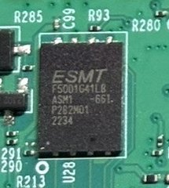

## 4. The serial console

The console runs at **115200 baud, 8N1**. It was reached with a USB-serial
board using an FTDI FT232RNL chip, attached to a Linux machine. Both
directions work; `tools/tx_test.py` checks the transmit wire on its own.

**Logic level.** On the first unit, with the board powered, the owner's
multimeter read about **1.8 V** between `GND` and `TX`, with a slight
variation, and **3.3 V** between `GND` and `VCC`. A multimeter averages the
signal while the board transmits, so the variation is expected; when the
reading was taken relative to serial activity was not recorded. The second
unit was not measured. The `TX` reading matches the adapter's `1V8` jumper.
No separate level adaptation is used. **3.3 V logic has not been validated.**

**Pinout.** Both boards have four pads labelled `GND`, `VCC`, `RX`, `TX`, in
that left-to-right order with the labels upright in the close-ups below. The
second view shows the pads with the board still in the case. Do not connect
the `VCC` pad (a supply, not the logic level) or adapter VCC. Wire `GND` to
`GND`, board `TX` to adapter `RXD` and board `RX` to adapter `TXD`. Check the
labels and measure the pad voltage on your own unit before wiring it. The
bench photograph documents the equipment used; it does not verify each wire
or its electrical level.

On the reference design, GPIO 29 can carry the UART transmit line. On the
H80X it drives the blue status LED, so the OpenWrt device tree does not set
the UART pin function and keeps the bootloader's setting. Under the stock
firmware, the console prints `Please press Enter to activate this console`,
followed by a login program according to the stock `inittab`. That console
was never used interactively.

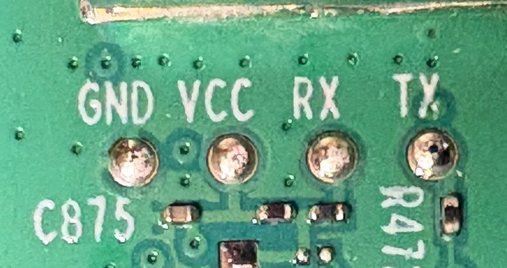

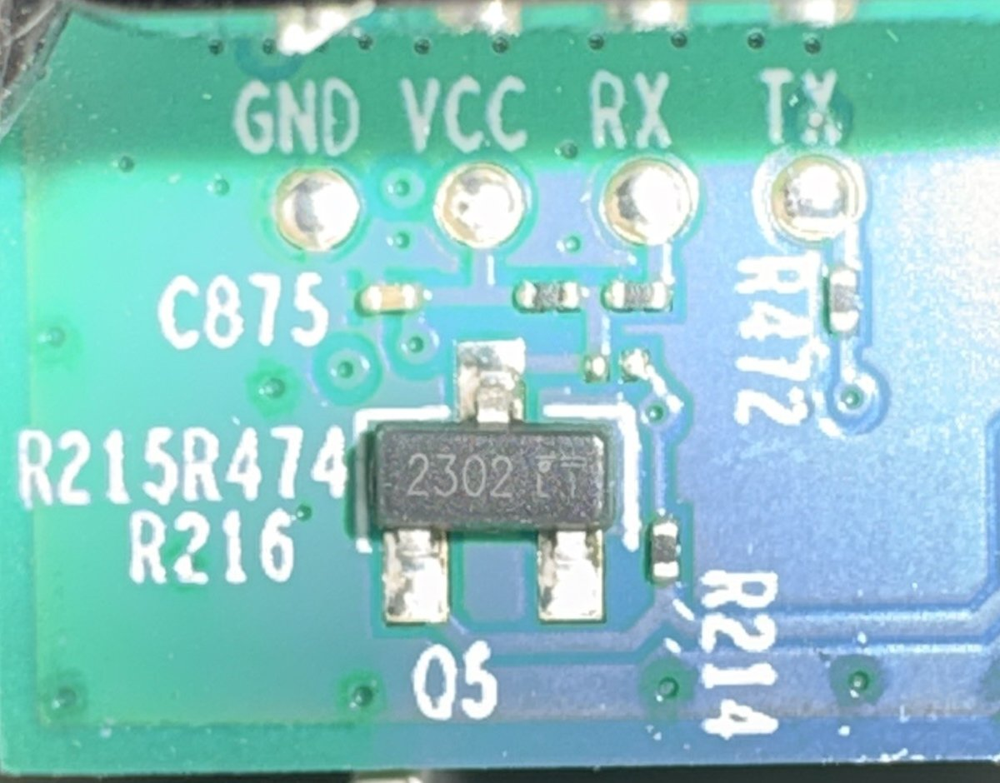

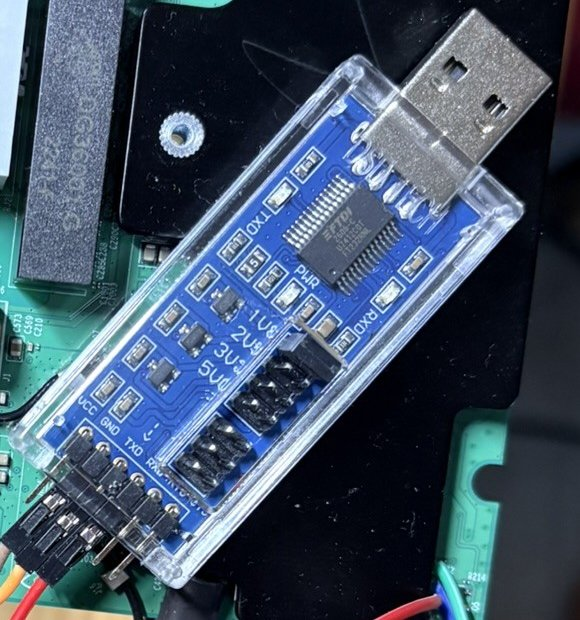

## 5. Stopping U-Boot

At power-on, U-Boot prints `Enter magic string to stop autoboot in 1
seconds`. The magic string is **`tpl`**; it gives the `IPQ5018#` prompt.
Typing it within one second by hand is unreliable. Start
`tools/stop_uboot.py` first, then power-cycle the device. The script waits
for the U-Boot banner, sends `tpl` repeatedly for up to six seconds, and
reports a failure if it sees the kernel start instead.

On this unit, the secure boot fuse is **not** enabled (U-Boot's own check
reports it). The U-Boot environment only contained `baudrate` and
`has_default_mac`; the bank-selection variable `tp_boot_idx` (section 10)
was absent.

During the RAM tests, the project rule was to change U-Boot variables only in
RAM with `setenv`, never with `saveenv`. This is a stated rule; no complete
command log proves it. The U-Boot environment was changed persistently once,
when the authorised installation of 13 November 2026 set the bank flag
(section 10).

## 6. Backing up the NAND

Nothing was changed before a full copy of the flash existed. U-Boot read the
128 MiB NAND into RAM in eight 16 MiB chunks, computed a CRC32 of each chunk,
and sent each one to a PC over TFTP (`tftpput`).

This U-Boot's TFTP client always talks to port 69, rejects replies that do
not come from port 69, and insists on option negotiation (`blksize 1468`,
`timeout 5`). Common TFTP servers did not cope, so the project wrote
`tools/tftp_server.py`, which both sends and receives. The receiving
machine's firewall must allow the transfers; here a second machine with
temporary firewall rules received them.

**Checks.** According to the journal, the CRC32 of each chunk matched
between U-Boot and the PC; a later check matched the files against the CRC
values recorded by the session script, but the U-Boot console output itself
was not re-examined independently. The original `tools/verify_split.py`
(with check values specific to this backup) refused to assemble the image on
a wrong chunk size or CRC, then cut it into one file per partition with a
SHA-256 manifest; the public repository ships a generic version that takes a
user-supplied manifest (see `docs/TOOLS.md`). The bootloader is present in
its partition, and the calibration partition is not empty. A later local
check matched all 18 manifest entries and the assembled image; in both
banks, the kernel image and the SquashFS root were identical to the public
1.1.0 package.

**Limits.**

- `nand read` returns ECC-corrected data **without the spare (OOB) area**. The
  backup is not a raw physical copy of the chip. It is intended for a restore
  from U-Boot.
- **A restore has never been tried.** A second, independent copy of the
  backup is not documented either.
- The `factory_data` partition holds the unit's identifiers and a **private
  RSA key**. The backup therefore stays on the owner's machine, outside
  version control, and is not published, quoted or summarised anywhere.

The flash layout, as read from the bootloader and later from Linux:

| # | Partition | Offset | Size | Role |
|---|---|---|---|---|
| 0–6 | `0:SBL1`, `0:MIBIB`, `0:BOOTCONFIG`, `0:BOOTCONFIG1`, `0:QSEE`, `0:DEVCFG`, `0:CDT` | 0x0 | 0x300000 in total | Early boot chain and configuration |
| 7 | `0:APPSBLENV` | 0x300000 | 0x80000 | U-Boot environment |
| 8 | `0:APPSBL` | 0x380000 | 0x140000 | U-Boot |
| 9 | `0:ART` | 0x4c0000 | 0x100000 | Wi-Fi calibration |
| 10 | `0:TRAINING` | 0x5c0000 | 0x80000 | Empty |
| 11 | `rootfs` | 0x640000 | 0x2a00000 | Firmware bank 0 (UBI) |
| 12 | `rootfs_1` | 0x3040000 | 0x2a00000 | Firmware bank 1 (UBI) |
| 13 | `0:ETHPHYFW` | 0x5a40000 | 0x80000 | Empty |
| 14 | `factory_data` | 0x5ac0000 | 0x900000 | Identity data, MAC address (UBIFS) |
| 15 | `runtime_data` | 0x63c0000 | 0x1100000 | Stock settings (UBIFS) |

## 7. Studying the stock firmware

### Booting the stock kernel from RAM

The first test checked the RAM-boot method without any deliberate write to
the flash. The stock kernel volume, extracted from the backup with
`tools/ubi_extract.py`, was loaded over TFTP to `0x44000000`, CRC-checked,
and started with `bootm 0x44000000#config@mp03.3`. The stock system booted
completely, Wi-Fi included. It still mounted its root filesystem from the
flash, so internal writes by the stock firmware cannot be ruled out.

Its kernel command line contained `swiotlb=1 coherent_pool=2M`, added by the
`bootargs-append` property of the stock device tree; Wi-Fi needs the second
parameter (section 8). Images can be loaded between `0x44000000` and about
`0x4A800000`, below the relocated U-Boot at `0x4A920000`.

### What the stock files reveal

All the Wi-Fi parameters came from readable scripts and from the stock device
tree, without disassembling any driver:

- calibration data at offsets `0x1000` and `0x26800` of `0:ART`, 128 KiB each;
- board IDs `0x24` (IPQ5018) and `0x60` (QCN6122);
- board data files (BDF) in CA, DE, JP and US variants, with DE as the factory
  setting;
- start parameters for the QCN6122, including its reset line on GPIO 15.

The stock Wi-Fi firmware is `WLAN.HK.2.5.r4-00622`. The proprietary
`qca-wifi` drivers that go with it cannot be used with a 6.x kernel. The
stock device tree, decompiled with `tools/dtb2dts.py`, was kept as a
reference.

### Can it be installed without opening the case? Not with any method demonstrated so far

**The stock web page** hands the file to the stock updater, `nvrammanager`,
which checks and writes it. Part of that check is shared with OpenWrt's
`mercusys-fwup.py`, which builds installable images for the MR80X v2. But
static analysis of the H80X updater found that, as far as that analysis
goes, writing requires a valid vendor RSA signature, so the MR80X method
cannot be used with the H80X installer studied. No such installation was
attempted. A signed image is written to the inactive bank, then
`tp_boot_idx` is set.

**Older stock firmware.** The public versions that can be unpacked (1.0.0,
1.1.0, 1.1.1, 1.1.3) carry the same `nvrammanager`, byte for byte. The
updater refuses an older major or minor version, so 1.0.0 would be refused
anyway. Version 1.1.2,
published for Singapore only, could not be extracted with the tools and
probes used: its content looks random and the known check of the Linux
updater fails on the raw file, so its updater is unknown. The Halo H3000X
1.1.1 file is byte-identical to the H80X 1.1.1 file.

**The bootloader's recovery page.** Holding the reset button at power-on
starts a small web server in U-Boot, before Linux. The GPL source defines the
recovery key as GPIO 33 (the Linux reset button), and the register address
tested by the binary matches. Source and binary strings agree: the page keeps
the upload in RAM and checks an MD5 and an RSA signature (128 bytes, so
RSA-1024, against a public key built into U-Boot) **before** any write. On
failure it writes nothing; on success it writes the bank opposite the current
one and updates `tp_boot_idx`. This path has never been exercised on the
hardware. It is a way back to signed stock firmware; it cannot install
OpenWrt.

**Administration services.** Administration components are present in the
stock image. Apart from the SSH server observed on one unit (next
subsection), their accessibility has not been validated, and no
installation route through them had been found in that initial study.
Password tests and authentication bypasses were outside its scope;
the later factory-setup investigation is described below.

**Conclusion.** A later survey of the methods used on related TP-Link and
Mercusys devices reached the same verdict: installing without the serial
console is unlikely as things stand, though not ruled out in principle.

### An SSH server in the stock firmware

On the tested Halo, running Mercusys firmware, an SSH server answered on
**TCP port 20001**, not 22. Its banner was `SSH-2.0-dropbear`. When queried
for the `root` account, without sending a password or opening a shell, it
offered the `publickey` and `password` methods. Its host key was a
**512-bit RSA key** (`ssh-rsa`), which modern SSH clients refuse. No login
was attempted or obtained. This is a historical observation and was not
retested. Nothing shows that every Halo exposes this service.

In the firmware, the shipped `/etc/config/dropbear` sets `Port 20001`,
`PasswordAuth on` and `RootPasswordAuth on`. Analysis of firmware 1.1.0
identifies Dropbear 2019.78. The network banner gives no version, so the
version actually running is not confirmed. The init script alone does not
start a daemon with the shipped configuration. Which component starts the
observed server is not established.

The root entry in `/etc/shadow` is identical in the four stock firmware
versions examined (1.0.0 to 1.1.3). It is also identical to the hash quoted
in a [public Reddit thread](https://www.reddit.com/r/hacking/comments/fsh9qx/cracking_a_hash_with_a_strange_salt/)
about a TP-Link Deco M9+. Commenters there report the same value on other
TP-Link products. That initial study did not try to recover the password and did not log in.
The later, separate access attempts below also obtained no shell.

### Follow-up: factory-reset setup, 14–15 November 2026

A later investigation tested whether a factory-reset Halo, in its stock setup
state and advertising firmware 1.1.3, could be accessed and installed through
software alone. It covered TDP discovery, stock SSH authentication, TMP
pairing, TDDP production-mode checks, session-protected web handlers, older
firmware and the application's setup flow. A corrected radio capture showed
discovery traffic and no local SSH session during the observed completed
setup; a WAN/cloud continuation is an interpretation, not a decoded exchange.
None of these paths opened a system session, installed an authorised key or
wrote a firmware image.

The [factory-reset investigation note](FACTORY-RESET-INVESTIGATION.md) records
the outcomes, capture limitations and unresolved questions, and distinguishes
ordinary factory setup from U-Boot recovery. These results were reported from
a private log (`BILAN.md`), not retested for this documentation update. No
software-only installation was demonstrated; that does not prove one is
impossible in every configuration.

## 8. The port

### Starting point

The port is based on OpenWrt `main` at commit `30a23ae451` (r38212), with
Linux 6.18.60 and the target `qualcommax/ipq50xx`. Two supported devices
served as references: the **Mercusys MR80X v2** (same SoC, switch and flash,
but 256 MiB of RAM; its upstream support leaves Wi-Fi disabled for lack of
memory) and the **TP-Link Archer AX55 v1** (IPQ5018 with QCN6122, 512 MiB of
RAM and two firmware banks).

A single script, `openwrt/add_h80x.py`, applies all the project's additions
to an OpenWrt tree, and running it twice gives the same result. It adds the
device tree and the image recipe; the MAC, LED and calibration scripts and
the `factory_data` mount; the U-Boot environment entry and the
bank-switching upgrade case; a fix to the shared NAND upgrade helper; and two
first-boot safety scripts. A full build took about 45 minutes on 8 cores.

### Device tree and partitions

The device tree started from the MR80X v2 one and was adapted to the H80X's
stock device tree: switch reset on GPIO 39, the button and LED GPIOs listed
above, three Ethernet ports, and no UART pin setting. The CPU talks to the
switch over SGMII at 1000 Mbit/s, set the same way on both ends, and the link
was observed at 1 Gbit/s. The stock device tree forces SGMII at
2500 Mbit/s; the speed actually used by the stock firmware was not measured
(section 13).

In the installable device tree, only three partitions can be written under
OpenWrt's kernel: `0:APPSBLENV` (U-Boot environment), `rootfs` and
`rootfs_1` (the two firmware banks). The other thirteen are read-only,
including the whole boot chain, `0:ART` and `factory_data`. The device tree
used for early RAM boots kept all sixteen read-only. These flags do not
protect against U-Boot commands or another kernel. The device tree appends
`root=/dev/ubiblock0_1 coherent_pool=2M` to the kernel command line; U-Boot
supplies `ubi.mtd=rootfs` or `ubi.mtd=rootfs_1`, depending on the bank.

### MAC addresses, read without writing

The stock firmware keeps the base MAC address in a 6-byte file,
`default-mac`, in the UBIFS volume of `factory_data`. The kernel attaches
that partition read-only, as marked in the device tree, and an early boot
script mounts the volume read-only to read the address. The project keeps
the stock offsets:

| Interface | Address |
|---|---|
| LAN, `eth0`, label | base |
| WAN | base + 1 (not used: no WAN port is defined) |
| 2.4 GHz radio | base + 2 |
| 5 GHz radio | base + 3 |

The MR80X v2 uses base - 1 and base - 2 for its radios; both conventions
exist in TP-Link's stock scripts. Without this step, OpenWrt runs with
U-Boot's placeholder address. In read-only mode, UBIFS reports that the
`factory_data` volume "needs recovery" and defers it. No repair was
attempted. The port LEDs follow the link state of each port through
OpenWrt's `netdev` trigger.

### Wi-Fi, board data files and `coherent_pool=2M`

The device tree enables the Q6 co-processor with the stock start parameters
and declares two radios: the internal 2.4 GHz radio and the QCN6122 for
5 GHz. Both use memory mode 1, at OpenWrt's standard addresses for that mode
rather than the stock ones, and a calibration variant string specific to the
H80X.

**Without `coherent_pool=2M`, Wi-Fi does not start.** The first attempt
failed with `DMA pool exhausted for pd-1`, then `Failed to load program
segments: -12`. The OpenWrt device tree now adds `coherent_pool=2M`, the
value the stock device tree adds.

Both radios report default identifiers over QMI (`chip_id 0`,
`board_id 0xff`). This suggests that no board identity was programmed into
their one-time-programmable area, but that area was not read in full. The
driver therefore asks for the board data by this name; for the QCN6122, a
debug build confirmed an exact match, with no fallback to a generic entry:

`bus=ahb,qmi-chip-id=0,qmi-board-id=255,variant=Mercusys-Halo-H80X-v1`

The board data files are `bdwlan_DE.b24` (IPQ5018, from the archive for
hardware version 1) and `bdwlan_DE.b60` (QCN6122), taken from stock firmware
1.1.0 and byte-identical to the files in the public 1.1.0 package.
[WIFI-BDF.md](WIFI-BDF.md) gives their paths and the private build steps.
`openwrt/make_board2.py` packs each one, unchanged, into the `board-2.bin`
container that `ath11k` expects. OpenWrt ships a newer Wi-Fi firmware
(`WLAN.HK.2.7.0.1-01744`) than the one these files were made for (2.5). The
combination worked in the recorded tests once `coherent_pool=2M` was added.
This does not prove general compatibility. The per-unit calibration is a
separate file, extracted at boot from `0:ART`; it does not depend on the
board data files.

**Licence.** No text consulted grants the right to republish these two
files. They are kept out of version control and will not be in the public
repository. OpenWrt has accepted board data files taken from other vendors'
stock firmware (for example the Archer AX55 v1). That precedent does not grant
any rights over the H80X files. A first upstream proposal without Wi-Fi would
follow the MR80X v2 precedent.

**Never unload `ath11k` while the system runs.** On the IPQ5018, `rmmod ath11k`
leaves the Q6 co-processor unable to restart (`failed to boot the remote
processor Q6`) until a hardware reset.

### Image recipe and upgrade path

The image recipe follows the MR80X v2: a FIT kernel image stored inside UBI,
no `factory.bin` (the stock web page cannot install it, see section 7), and a
maximum image size of one bank (43008 KiB). The resulting `sysupgrade.bin`
is a tar archive with a control file, the kernel and the root filesystem.
The U-Boot environment settings for `fw_printenv`/`fw_setenv` match the stock
configuration.

The upgrade case for the H80X, in `platform.sh`, follows this ordinary path:

1. It reads `tp_boot_idx`. If the value read is exactly `1`, the preferred
   bank is `rootfs_1` and the target is `rootfs`. Any other result makes
   `rootfs_1` the target. The current code does not distinguish a failed read
   of the environment from an absent variable.
2. It removes the stock volumes from the target bank and writes the new
   firmware.
3. **Only if the write succeeded**, it sets `tp_boot_idx` to `1`, or clears
   it when the target is `rootfs`.

OpenWrt's option to write the current bank instead is also kept. With that
option, the current bank is written and the bank flag is left unchanged.

Step 3 needed a fix in shared OpenWrt code. Two independent reviews found
that the common NAND helper (`nand_upgrade_tar` in `nand.sh`) ended with an
unconditional `return 0`. A failed volume write was therefore reported as a
success, and the bank flag would have been switched anyway. A simulation
reproduced it. The integration script patches the helper: it collects the
status of each write and uses `pipefail`, checks that the target volumes
exist, returns the real status, and really stops on failure. It does not read
back what was written, and a power cut during the write or during
`fw_setenv` stays outside its control.

### First-boot safety scripts

Two scripts run once, at first boot, before the network starts:

- `99-h80x-test-lan` turns the LAN into a DHCP **client** and disables the
  DHCP server, router advertisements and DHCPv6 on it. Section 14 explains
  why.
- `99-h80x-wifi-safe` sets every Wi-Fi interface to WPA2 (`psk2`) and
  disabled. It generates a random key per interface on the device (32 bytes
  from `/dev/urandom`, 64 hex characters) and sets the country to DE. It never
  enables Wi-Fi.

No Wi-Fi key exists in the sources or in the images.

**HTTPS.** On the installed image, the web interface answered on HTTP only:
the TLS library was present, but no certificate generator was included, so
`uhttpd` started without HTTPS. Installing the missing package
(`px5g-mbedtls`) fixed it: TLS 1.3 and HTTP 200 were observed. The package
was added to the recipe. **No full image has been rebuilt since**, and nobody
has checked whether the fix survives a reboot.

## 9. Testing in RAM

The initramfs images were booted from RAM over TFTP, and no deliberate write
command was run during these checks. The sysupgrade images were inspected
off the device before the installation (section 10). The sequence at the
U-Boot prompt:

```text
setenv autoload no
dhcp
setenv serverip <address of the TFTP server>
tftpboot 0x46000000 <image>.itb
crc32 0x46000000 <size>          # compare with the CRC computed on the PC
setenv bootargs console=ttyMSM0,115200n8
bootm 0x46000000#config@mp03.3
```

Set `autoload no` before `dhcp`. Without it, U-Boot's `dhcp` tries on its own
to download a default file name over TFTP. This happened once, when quoting
problems between two shells mangled the commands; the file did not exist and
nothing booted. For the documented TFTP boots, the CRC computed in U-Boot was
compared with the local one.

### What the RAM tests showed

RAM boots of one unit, 12–13 November 2026:

- **System**: OpenWrt `r38212-30a23ae451`, Linux 6.18.60, board name
  `mercusys,h80x-v1`. About 432 MB of RAM available, about 240 MB with Wi-Fi
  loaded. Serial console, SSH and the LuCI web interface working.
- **Switch**: the driver found the RTL8367S and created `lan1` to `lan3`,
  with an SGMII 1 Gbit/s link to the CPU. In U-Boot, `mii info` sees nothing
  on that bus. This is expected: the switch does not present itself as a PHY.
- **Flash**: the NAND and its 16 partitions detected; on the first boot,
  nothing attached or written. With the installable device tree, exactly
  three writable partitions (`0:APPSBLENV`, `rootfs`, `rootfs_1`),
  `factory_data` mounted read-only, both radios up and no `ath11k` crash.
- **LEDs and button**: LEDs checked by eye, one by one. Each reset press seen
  on GPIO 33; the reset handler was disabled during this test, so that a
  press would not reboot the device, and restored afterwards.
- **MAC addresses**: correct (base, +2, +3).
- **Wi-Fi**: both radios up once `coherent_pool=2M` was in place. A phone
  associated to test access points protected with WPA2, country DE. Link
  readings with the phone as client: 1200.9 Mbit/s on 5 GHz (HE80, MCS 11,
  two streams, -46 dBm) and 155–172 Mbit/s on 2.4 GHz (HE20, MCS 6–7, two
  streams). **These are PHY link rates, not throughput. No throughput test
  was run.**
- **Robustness**: ten cycles of `wifi down` and `wifi up` brought both radios
  back every time, with no `ath11k` error or recovery and no net memory loss.
  160 MHz on channel 36 worked after the 60-second radar check. 40 MHz on
  2.4 GHz fell back to 20 MHz because of nearby networks, which is normal.
  The CPU stayed around 50 °C.
- **First boot of the WPA2 image**, with no manual change: both radios
  present, the expected partition flags, and the same Wi-Fi and LAN defaults
  as checked after installation (section 10).
- **RAM image with the NAND fix**: the running `nand.sh` and `platform.sh`
  matched the patched build by SHA-256.

An independent offline audit checked the installation images against the
hashes recorded in the local build report and found the two first-boot
scripts byte-identical to the sources. It accepted the images with
reservations: persistence after installation was not proven at that point,
and some error paths are handled less broadly than the report claimed.

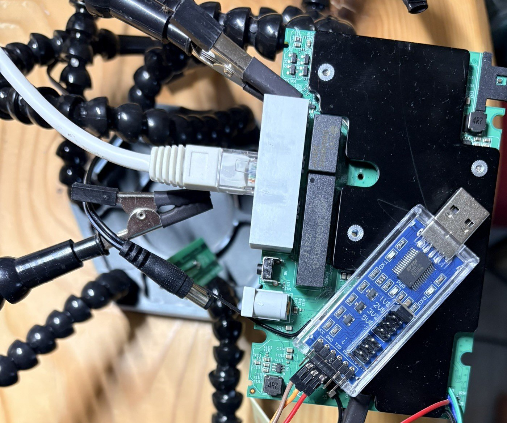

## 10. Installing to flash: the A/B scheme

### How U-Boot picks a bank

Reading the GPL U-Boot source, confirmed against the binary, gives the
following rules:

- `tp_boot_idx` equal to exactly `1` boots `rootfs_1`. Absent, `0` or any
  other value boots `rootfs`.
- A different variable, `boot_idx`, takes priority if it exists. It allows a
  single attempt. The `tp_boot_idx` rule above and the retry below apply only
  when `boot_idx` is absent.
- If `boot_idx` is absent and loading the chosen bank fails inside U-Boot,
  U-Boot tries the other bank once.
- There is **no boot counter**, and U-Boot does not read `0:BOOTCONFIG` on
  this board. A kernel that starts and then crashes is not detected: the same
  bank is tried again at the next power-on.

### The installation

The installation was done on 13 November 2026. The journal records the
owner's explicit approval for this step. The steps:

1. Boot the WPA2 initramfs from RAM, as in section 9.
2. Copy `sysupgrade.bin` onto it and compare its SHA-256 with the local file.
3. Run `sysupgrade -T` (image test only), which returned success.
4. Check `tp_boot_idx`. It was absent, so the target was `rootfs_1`.
5. Run `sysupgrade -n -v`. The serial log showed `ubi1: attached mtd12 (name
   "rootfs_1")` and then `sysupgrade successful`.
6. Reboot. U-Boot found the bank flag and loaded the OpenWrt kernel. The
   first boot created the persistent overlay, and `factory_data` stayed
   read-only.

After a second reboot, the overlay was found again rather than recreated.
Checked: `tp_boot_idx=1` and a SquashFS root; the U-Boot environment tools in
place and the NAND fix present; on the LAN, a DHCP client, no DHCP, DHCPv6 or
router-advertisement service and no socket on UDP 67 or 547 (`dnsmasq` still
answers DNS on port 53); two Wi-Fi interfaces in `psk2`, disabled, country
DE, with 64-character keys (length only), no interface created; the
first-boot scripts removed after running.

The journal states that the write targeted `rootfs_1`, not the stock bank
`rootfs`. The integrity of `rootfs` was not read back after the installation.

### What the A/B scheme does not protect

- The `rootfs` bank is **writable** under OpenWrt. Keeping the stock firmware
  there depends only on the bank-selection logic.
- The **next ordinary `sysupgrade`** from the installed OpenWrt will target
  `rootfs`, and so **will overwrite the stock copy**.

## 11. Going back to stock, and its limits

Three ways back are documented. **None has been tested.**

1. **U-Boot's recovery page.** Hold the reset button at power-on and upload
   the signed official firmware. The page checks the signature before
   writing (section 7). It runs before Linux, so a broken OpenWrt bank does
   not block it, as long as the bootloader partitions are intact. The address
   of the page is uncertain: the page text names one address and the
   compiled default environment contains another. Neither has been observed
   on the network. In the GPL U-Boot source studied, the
   recovery path checks that the image is compatible, but it contains no
   major or minor version comparison of the kind the Linux updater makes.
   Whether an older signed image would actually be accepted has not been
   tested.
2. **The serial console.** Clearing `tp_boot_idx` selects `rootfs` again,
   **as long as `boot_idx` is absent and that bank still holds the stock
   firmware**. This has not been tested.
3. **The NAND backup.** It is intended for a restore from U-Boot while the
   U-Boot partition is intact. That has never been tried, and the backup
   lacks the spare (OOB) area.

What is **not** guaranteed:

- an automatic return if OpenWrt starts and then crashes (there is no boot
  counter);
- the stock copy after a second OpenWrt upgrade (see above);
- recovery after a power cut while the U-Boot environment is being written.
  Its effect has not been studied on the hardware.

## 12. Current state and limits (13 November 2026)

**Tested on one unit, installed in flash since 13 November 2026.**

| Area | State |
|---|---|
| Boot from flash, A/B switch | Observed, two boots. The stock bank was not the write target; it was not read back afterwards |
| Ethernet, switch, three ports | Observed in RAM. The test link ran at 100 Mbit/s, cause not established (cable or remote port are hypotheses); gigabit on the ports was not shown |
| LEDs | Observed in RAM, checked by eye |
| Reset button | Seen electrically in RAM; on the installed system the software path was traced, but a physical press was not observed |
| Wi-Fi 2.4 / 5 GHz | Observed in RAM, including client association and HE160 on channel 36. On the installed unit, the access points are **disabled**. WPA2 association after installation, long-term stability and throughput are untested |
| MAC addresses | Observed: base, +2, +3 |
| HTTPS for the web interface | Observed after adding a package; not yet in a rebuilt image, persistence after a reboot untested |
| VLAN per SSID (the end goal) | Not tested |

**Known limits.**

- **Board data files.** Their redistribution rights are not established, so
  they are not published. Without them, Wi-Fi does not work, and an image
  rebuilt from this repository alone has no Wi-Fi.
- **5 GHz channels 100 and above** are disabled. Channels 36–64 work, with
  52–64 subject to radar detection. With the board data file in use, a debug
  build showed the QCN6122 firmware itself announcing only four regulatory
  rules: 2.4 GHz, 5170–5250 MHz, 5250–5330 MHz, and a 6 GHz range the radio
  cannot use. Other country codes did not add the upper band. The stock
  driver also reports only 8 channels on 5 GHz at boot, so the stock firmware
  probably does not use the upper band either; that observation is partial.
  The other stock board-file variants differ in a region code and power
  tables; they were only compared offline, none was booted, and their effect
  on the hardware remains untested. The device tree's frequency limit and the
  driver options, examined in the files, offer no override.
- **CPU–switch link at 1 Gbit/s.** A 2.5 Gbit/s variant is drafted but not
  applied or tested on the H80X (section 13).
- **Ports.** The three ports are all LAN. No WAN port is defined.
- **Going back to stock**: see section 11.
- **Upstream**: nothing has been submitted. Open OpenWrt pull requests touch
  the same code: a common function for `tp_boot_idx` on TP-Link and Mercusys
  boards, and the 2.5 Gbit/s link of the MR80X v2.

## 13. The 2.5 Gbit/s variant

The device tree change is small: set `2500base-x` and 2500 Mbit/s on both the
SoC side and the switch's CPU port. On a related board, a public report
describes changing only one side: most boots then failed to transmit. Even
with both sides changed, an intermittent fault (link up, no traffic) needs a
driver fix that was still under review in OpenWrt and had not been merged.
The draft is kept apart from the tested configuration.

## 14. Incidents, dead ends and lessons

**The DHCP incident.** The first OpenWrt test image came up with OpenWrt's
default LAN settings: a static address and an active DHCP server. The unit
was plugged into the home network, and that server **gave a lease to a
household device** before it was stopped. The fix has two parts: a
first-boot script that turns the LAN into a DHCP client and disables the
DHCP server, DHCPv6 and router advertisements (installed by the integration
script, checked in RAM and after installation); and a standing project rule:
never plug a test image into a live network without that protection, and
check `dhcp.lan.ignore=1`. Lesson: OpenWrt's defaults assume it is the
router. On someone else's network, change the defaults before the first
boot.

**Unloading the Wi-Fi driver.** Reloading `ath11k` on the running system
left the Q6 co-processor unable to restart, and Wi-Fi was gone. After a
reboot, the unit ran the stock firmware from flash, because a RAM image does
not survive a reboot. That console gave no shell, and there was no remote
power control. To return to U-Boot without a flash write, a serial BREAK
followed by SysRq `c` (crash) was used: the watchdog rebooted the unit, and
U-Boot could be interrupted again. The stock SysRq mask allows only crash,
power-off and minidump, and power-off could not have been undone remotely.
Lesson: put debug options in the image at boot, not in a running system. A
later check confirmed that the debug module is absent from the installation
images.

**Other lessons.**

- In U-Boot, set `autoload no` before `dhcp` (section 9).
- The integration script can skip a step without failing. A wrong path meant
  that the U-Boot environment configuration was never installed: the script
  printed "file not found, step skipped" and carried on. The H80X case was
  also never inserted into `platform.sh`, so an upgrade would have fallen
  back to the generic routine, without bank switching. A rebuild found both
  gaps, and both were fixed. Read the script's output (section 16).
- OpenWrt's default Wi-Fi configuration is `encryption=none`, with the
  interfaces disabled. That is not an open access point, but it breaks the
  project rule "always WPA2". The `99-h80x-wifi-safe` script (section 8) sets
  WPA2 instead.
- Reviews of the code that writes to flash found the false success in the
  NAND helper (section 8), and the missing HTTPS generator showed up only
  after installation. Only the result of a real NAND write could not be shown
  by a RAM test. Test the artefact you will install, and review the code
  paths that write.
- Each image was recorded with its size and checksum, so each test can be
  traced to an exact file.

**Dead ends.** The stock web page, U-Boot's recovery page and older or
sister-model firmware as installation routes (section 7); unlocking 5 GHz
channels 100+ (section 12); a `factory.bin` and the `UbiFit` image layout,
both dropped from the recipe.

**Corrections.** This text uses corrected versions of early conclusions;
some historical project documents still carry the outdated wording. A memory
address first attributed to the QCN6122 belongs to the disabled QCN9000
slot. The 5 GHz limit, first blamed on the DE board file, comes from the
rules the radio firmware announces. The MR80X install method does not apply.
"Guaranteed return to stock" overstated what has been tested.

## 15. Who did what: AI agents and the human

This project relied heavily on AI agents. According to the project notes, the
owner set this organisation: Claude orchestrates and verifies, GPT-based and
Cursor agents carry out delegated tasks, and a separate model runs
counter-checks. A check by another model does not replace human review.

Agents did the offline analysis on copies (device tree, MAC addresses, Wi-Fi,
installation, LEDs, disassembly of the stock updater and U-Boot, older
firmware, licence research), each task with a written brief and a report and
without touching the device. The orchestrating agent re-checked key findings
itself, such as the updater disassembly. Agents drove the serial console and
the RAM tests through the Linux machine attached to the UART. Independent
reviews covered the pre-install state, the flash-write path and the WPA2
images. Agents wrote and checked this text.

The owner had physical access to the unit, gave explicit approval before any
flash write, and decided on publication, licence and scope. The owner reports
opening both cases with plastic tools; the owner's notes report the first
serial dialogue, the backup and the stock RAM boot. Who wired the UART and
handled the phone for the Wi-Fi client tests is not recorded in the project
files.

## 16. How to reproduce

**This is a record of what was done on one unit, not a supported installation
guide.** You may lose your device, its identity data or its warranty. Read
sections 4, 6 and 11 first.

1. **Build.** You need a Linux build host and an OpenWrt tree; the work used
   `main` at `30a23ae451`. Run:

   ```sh
   python3 openwrt/add_h80x.py <openwrt-tree> openwrt/install/ipq5018-h80x-v1.dts <board-files-dir>
   ```

   Then select `mercusys_h80x-v1` in `make menuconfig`, enable the initramfs
   image, and build. **Read the script's output.** If a file or a
   pattern is not found in a newer tree, some steps print a message and
   continue instead of failing; others stop with an error.
   Without board data files, the radios will not start (section 8).
2. **Serial console.** Open the case, identify and **measure** the UART pads,
   connect at the measured voltage, 115200 8N1. Stop U-Boot with `tpl`.
3. **Back up the NAND first**, as in section 6, and keep the backup private:
   it contains your unit's private key.
4. **If the unit is on a network you share**, make sure your image includes
   the LAN protection script before the first boot.
5. **Boot the initramfs from RAM** (section 9) and check everything there:
   partition flags, radios, MAC addresses, LAN behaviour.
6. **Install** from the initramfs with `sysupgrade`, as in section 10, only
   when you accept the risks in section 11.

Useful tools in this repository: `tools/stop_uboot.py`,
`tools/tftp_server.py`, `tools/verify_split.py`, `tools/ubi_extract.py`,
`tools/dtb2dts.py`, `tools/verify_wpa2_images.py`.

The reset switch is marked `SW1` on the board. It is accessible through the
small hole on the rear panel.

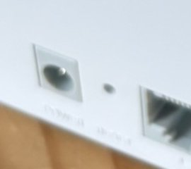

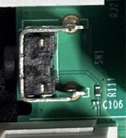

## 17. Licence and credits

**Licence.** On 13 November 2026 the owner chose the most open licence
possible. The repository is prepared with CC0-1.0 for documentation and
photos, MIT-0 for original code, and the original licence for files derived
from OpenWrt; see [LICENSING.md](LICENSING.md). The owner-supplied photographs
are CC0-1.0, copyright Etienne-T.

Files derived from OpenWrt keep their original licence. For example, the
device tree carries `GPL-2.0-or-later OR MIT`. The public
repository is meant to contain no stock firmware, no board data files and no
NAND backup; this will be checked on the final export before publication.

**Credits.**

- The OpenWrt project and the authors of the Mercusys MR80X v2 and TP-Link
  Archer AX55 v1 support, which this port builds on.
- The contributors to the OpenWrt forum thread on the MR80X v2.
- STNVIDNOYE, author of the [DNS Club review](https://club.dns-shop.ru/review/t-280-marshrutizatoryi/85194-obzor-domashnei-wi-fi-mesh-sistemyi-mercusys-halo-h80x-kompaktno/)
  of the Halo H80X (photographs watermarked `sergeytroshin.ru`), for the
  additional device photographs and component list.
- `ath11k-bdencoder` from qca-swiss-army-knife, used to check the board data
  container format.
- Mercusys, for publishing the GPL source of the H80X firmware.

The repository is maintained by Etienne-T. Text and code were largely
produced by AI agents under the owner's direction; see the README.
